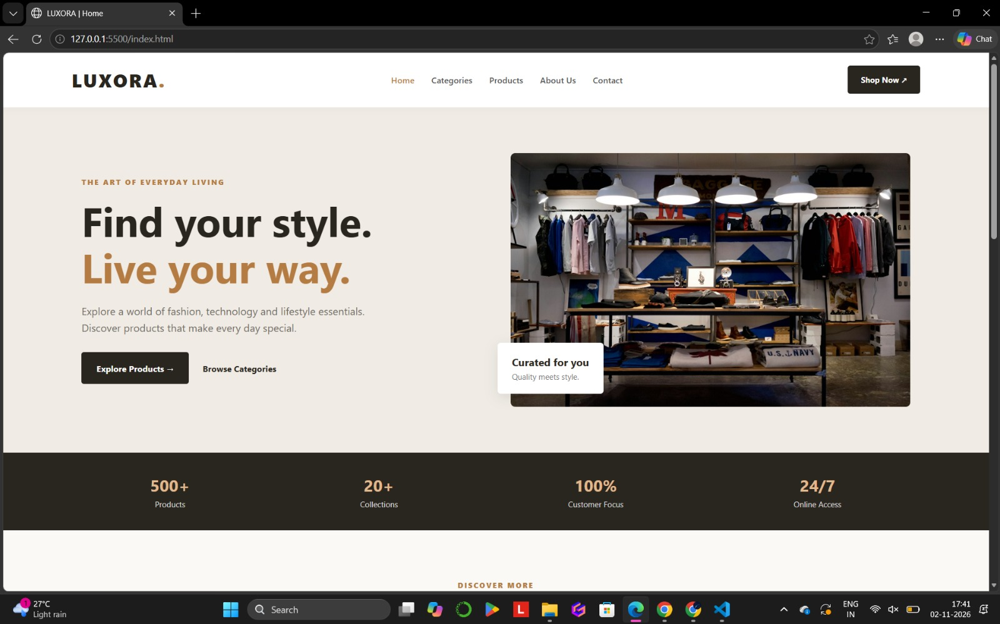
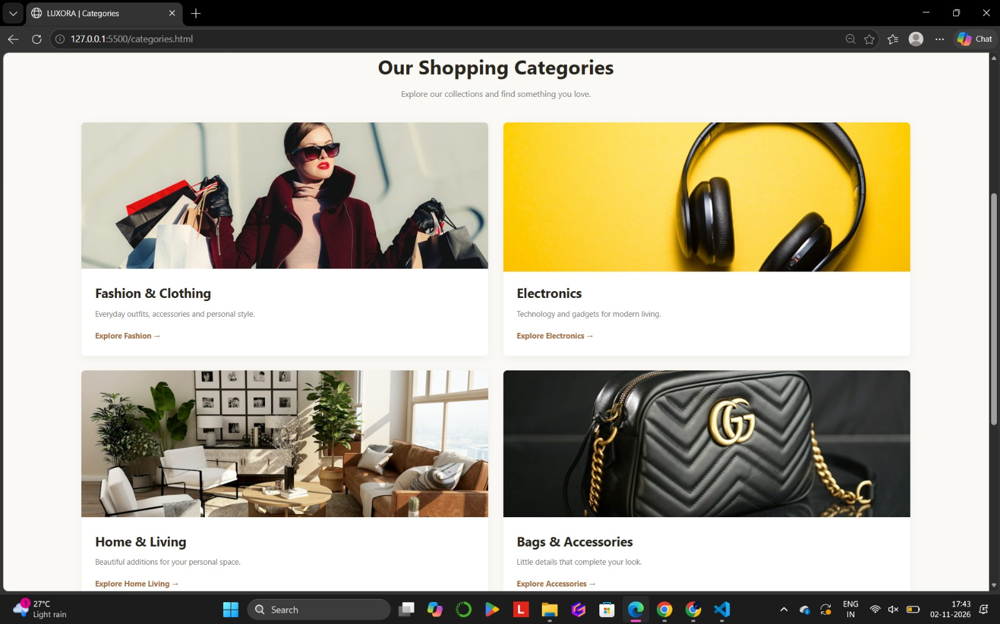
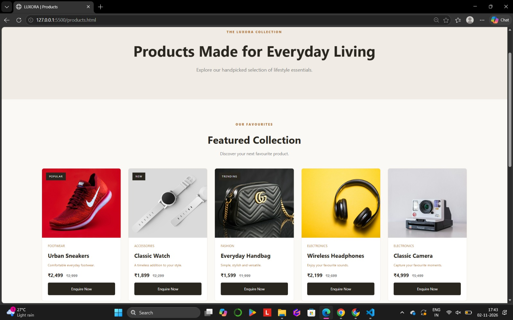
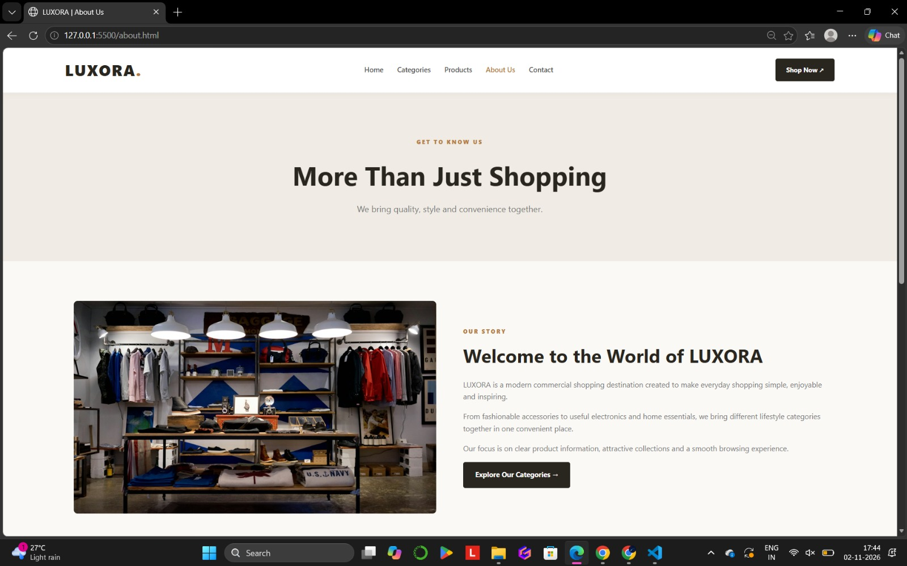
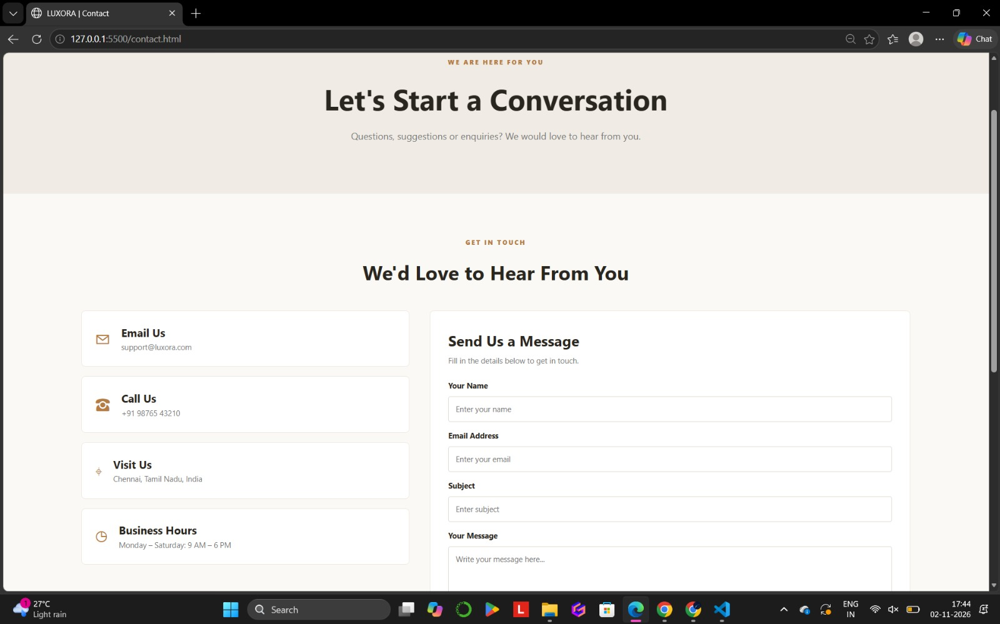

# Ex02 Commercial Website
## Date: 02-11-2026

## AIM
To create a commercial website using CSS Flexbox.

## ALGORITHM

### STEP 1
Create an HTML file (`index.html`) for the Home page.

### STEP 2
Create a CSS file (`style.css`) for styling all webpages.

### STEP 3
Create separate HTML files for Categories, Products, About Us, and Contact pages.

### STEP 4
Include a navigation bar with links to all five webpages.

### STEP 5
Add attractive homepage content with a welcome banner, featured categories, and promotional sections.

### STEP 6
Create product categories with suitable images and descriptions.

### STEP 7
Display products with images, names, prices, and enquiry links.

### STEP 8
Add an About Us page describing the company, its story, and values.

### STEP 9
Create a Contact page with contact details and a contact form.

### STEP 10
Design a common footer with navigation links, copyright information, student name, and register number.

### STEP 11
Define global styles for fonts, colors, backgrounds, and layouts.

### STEP 12
Use CSS Flexbox to arrange navigation links, category cards, product cards, and webpage sections.

### STEP 13
Add hover effects, transitions, and responsive media queries for different screen sizes.

### STEP 14
Add suitable images and media to make the website attractive and professional.

### STEP 15
Open the website using Live Server, test all navigation links, check responsiveness, and fix layout issues.

### STEP 16
Capture screenshots of all webpages and include them in the README file.

### STEP 17
Upload the completed project to GitHub and publish it using GitHub Pages.

## PROGRAM

### index.html:
```

<!DOCTYPE html>
<html lang="en">
<head>
    <meta charset="UTF-8">
    <meta name="viewport" content="width=device-width, initial-scale=1.0">
    <title>LUXORA | About Us</title>
    <link rel="stylesheet" href="style.css">
</head>
<body>

<header>
    <a href="index.html" class="logo">LUXORA<span>.</span></a>
    <nav>
        <a href="index.html">Home</a>
        <a href="categories.html">Categories</a>
        <a href="products.html">Products</a>
        <a class="active" href="about.html">About Us</a>
        <a href="contact.html">Contact</a>
    </nav>
    <a href="products.html" class="nav-button">Shop Now ↗</a>
</header>

<main>
    <section class="inner-banner">
        <p class="eyebrow">GET TO KNOW US</p>
        <h1>More Than Just Shopping</h1>
        <p>We bring quality, style and convenience together.</p>
    </section>

    <section class="about-page page-section">
        <div class="about-photo">
            
        </div>
        <div class="about-text">
            <p class="eyebrow">OUR STORY</p>
            <h2>Welcome to the World of LUXORA</h2>
            <p>LUXORA is a modern commercial shopping destination created to make everyday shopping simple, enjoyable and inspiring.</p>
            <p>From fashionable accessories to useful electronics and home essentials, we bring different lifestyle categories together in one convenient place.</p>
            <p>Our focus is on clear product information, attractive collections and a smooth browsing experience.</p>
            <a href="categories.html" class="main-button">Explore Our Categories →</a>
        </div>
    </section>

    <section class="values-section">
        <div class="section-title">
            <p class="eyebrow">WHAT WE BELIEVE IN</p>
            <h2>Our Values</h2>
        </div>
        <div class="benefit-grid">
            <div class="benefit-card"><span>✦</span><h3>Quality</h3><p>We focus on products selected for their usefulness and style.</p></div>
            <div class="benefit-card"><span>♡</span><h3>Customer Care</h3><p>We believe every customer deserves a pleasant experience.</p></div>
            <div class="benefit-card"><span>◇</span><h3>Innovation</h3><p>We aim to make browsing and discovering products easier.</p></div>
        </div>
    </section>

    <section class="home-promo">
        <p class="eyebrow">BE PART OF OUR JOURNEY</p>
        <h2>Discover something you will love.</h2>
        <a href="products.html" class="light-button">Explore Products →</a>
    </section>
</main>

<footer>
    <div class="footer-top">
        <div><a href="index.html" class="footer-logo">LUXORA<span>.</span></a><p>Everyday essentials, thoughtfully selected.</p></div>
        <div class="footer-links">
            <a href="index.html">Home</a><a href="categories.html">Categories</a>
            <a href="products.html">Products</a><a href="about.html">About</a>
            <a href="contact.html">Contact</a>
        </div>
    </div>
    <div class="footer-bottom">
        <p>© 2026 LUXORA. All Rights Reserved.</p>
        <p>Name: PRIYADHARSHINI P | Register Number: 212224040252</p>
    </div>
</footer>

</body>
</html>
```
### categories.html:
```

<!DOCTYPE html>
<html lang="en">
<head>
    <meta charset="UTF-8">
    <meta name="viewport" content="width=device-width, initial-scale=1.0">
    <title>LUXORA | Categories</title>
    <link rel="stylesheet" href="style.css">
</head>
<body>

<header>
    <a href="index.html" class="logo">LUXORA<span>.</span></a>
    <nav>
        <a href="index.html">Home</a>
        <a class="active" href="categories.html">Categories</a>
        <a href="products.html">Products</a>
        <a href="about.html">About Us</a>
        <a href="contact.html">Contact</a>
    </nav>
    <a href="products.html" class="nav-button">Shop Now ↗</a>
</header>

<main>
    <section class="inner-banner">
        <p class="eyebrow">EXPLORE OUR COLLECTIONS</p>
        <h1>Find Your Favourite Category</h1>
        <p>Discover products that match your taste and lifestyle.</p>
    </section>

    <section class="page-section">
        <div class="section-title">
            <p class="eyebrow">SHOP YOUR WAY</p>
            <h2>Our Shopping Categories</h2>
            <p>Explore our collections and find something you love.</p>
        </div>

        <div class="category-page-grid">
            <div class="large-category">
                
                <div><h2>Fashion & Clothing</h2><p>Everyday outfits, accessories and personal style.</p><a href="products.html">Explore Fashion →</a></div>
            </div>

            <div class="large-category">
                
                <div><h2>Electronics</h2><p>Technology and gadgets for modern living.</p><a href="products.html">Explore Electronics →</a></div>
            </div>

            <div class="large-category">
                
                <div><h2>Home & Living</h2><p>Beautiful additions for your personal space.</p><a href="products.html">Explore Home Living →</a></div>
            </div>

            <div class="large-category">
                
                <div><h2>Bags & Accessories</h2><p>Little details that complete your look.</p><a href="products.html">Explore Accessories →</a></div>
            </div>
        </div>
    </section>

    <section class="home-promo">
        <p class="eyebrow">YOUR STYLE, YOUR CHOICE</p>
        <h2>There is always something new to discover.</h2>
        <a href="products.html" class="light-button">View All Products →</a>
    </section>
</main>

<footer>
    <div class="footer-top">
        <div><a href="index.html" class="footer-logo">LUXORA<span>.</span></a><p>Everyday essentials, thoughtfully selected.</p></div>
        <div class="footer-links">
            <a href="index.html">Home</a><a href="categories.html">Categories</a>
            <a href="products.html">Products</a><a href="about.html">About</a>
            <a href="contact.html">Contact</a>
        </div>
    </div>
    <div class="footer-bottom">
        <p>© 2026 LUXORA. All Rights Reserved.</p>
        <p>Name: PRIYADHARSHINI P | Register Number: 212224040252</p>
    </div>
</footer>

</body>
</html>
```
### products.html:
```

<!DOCTYPE html>
<html lang="en">
<head>
    <meta charset="UTF-8">
    <meta name="viewport" content="width=device-width, initial-scale=1.0">
    <title>LUXORA | Products</title>
    <link rel="stylesheet" href="style.css">
</head>
<body>

<header>
    <a href="index.html" class="logo">LUXORA<span>.</span></a>
    <nav>
        <a href="index.html">Home</a>
        <a href="categories.html">Categories</a>
        <a class="active" href="products.html">Products</a>
        <a href="about.html">About Us</a>
        <a href="contact.html">Contact</a>
    </nav>
    <a href="contact.html" class="nav-button">Enquire ↗</a>
</header>

<main>
    <section class="inner-banner">
        <p class="eyebrow">THE LUXORA COLLECTION</p>
        <h1>Products Made for Everyday Living</h1>
        <p>Explore our handpicked selection of lifestyle essentials.</p>
    </section>

    <section class="page-section">
        <div class="section-title">
            <p class="eyebrow">OUR FAVOURITES</p>
            <h2>Featured Collection</h2>
            <p>Discover your next favourite product.</p>
        </div>

        <div class="product-container">

            <div class="product-card">
                <div class="product-image"><span class="product-label">POPULAR</span>
                    </div>
                <div class="product-info"><p>FOOTWEAR</p><h3>Urban Sneakers</h3><p>Comfortable everyday footwear.</p><div class="price">₹2,499 <span>₹2,999</span></div><a href="contact.html" class="product-button">Enquire Now</a></div>
            </div>

            <div class="product-card">
                <div class="product-image"><span class="product-label">NEW</span>
                    </div>
                <div class="product-info"><p>ACCESSORIES</p><h3>Classic Watch</h3><p>A timeless addition to your style.</p><div class="price">₹1,899 <span>₹2,299</span></div><a href="contact.html" class="product-button">Enquire Now</a></div>
            </div>

            <div class="product-card">
                <div class="product-image"><span class="product-label">TRENDING</span>
                    </div>
                <div class="product-info"><p>FASHION</p><h3>Everyday Handbag</h3><p>Simple, stylish and versatile.</p><div class="price">₹1,599 <span>₹1,999</span></div><a href="contact.html" class="product-button">Enquire Now</a></div>
            </div>

            <div class="product-card">
                <div class="product-image">
                    </div>
                <div class="product-info"><p>ELECTRONICS</p><h3>Wireless Headphones</h3><p>Enjoy your favourite sounds.</p><div class="price">₹2,199 <span>₹2,699</span></div><a href="contact.html" class="product-button">Enquire Now</a></div>
            </div>

            <div class="product-card">
                <div class="product-image">
                    </div>
                <div class="product-info"><p>ELECTRONICS</p><h3>Classic Camera</h3><p>Capture your favourite moments.</p><div class="price">₹4,999 <span>₹5,499</span></div><a href="contact.html" class="product-button">Enquire Now</a></div>
            </div>

            <div class="product-card">
                <div class="product-image">
                    </div>
                <div class="product-info"><p>HOME LIVING</p><h3>Modern Chair</h3><p>Comfort meets modern design.</p><div class="price">₹3,499 <span>₹3,999</span></div><a href="contact.html" class="product-button">Enquire Now</a></div>
            </div>

        </div>
    </section>

    <section class="home-promo">
        <p class="eyebrow">NEED HELP CHOOSING?</p>
        <h2>Let us help you find the right product.</h2>
        <a href="contact.html" class="light-button">Contact Our Team →</a>
    </section>
</main>

<footer>
    <div class="footer-top">
        <div><a href="index.html" class="footer-logo">LUXORA<span>.</span></a><p>Everyday essentials, thoughtfully selected.</p></div>
        <div class="footer-links">
            <a href="index.html">Home</a><a href="categories.html">Categories</a>
            <a href="products.html">Products</a><a href="about.html">About</a>
            <a href="contact.html">Contact</a>
        </div>
    </div>
    <div class="footer-bottom">
        <p>© 2026 LUXORA. All Rights Reserved.</p>
        <p>Name: PRIYADHARSHINI P | Register Number: 212224040252</p>
    </div>
</footer>

</body>
</html>
```
### about.html:
```

<!DOCTYPE html>
<html lang="en">
<head>
    <meta charset="UTF-8">
    <meta name="viewport" content="width=device-width, initial-scale=1.0">
    <title>LUXORA | About Us</title>
    <link rel="stylesheet" href="style.css">
</head>
<body>

<header>
    <a href="index.html" class="logo">LUXORA<span>.</span></a>
    <nav>
        <a href="index.html">Home</a>
        <a href="categories.html">Categories</a>
        <a href="products.html">Products</a>
        <a class="active" href="about.html">About Us</a>
        <a href="contact.html">Contact</a>
    </nav>
    <a href="products.html" class="nav-button">Shop Now ↗</a>
</header>

<main>
    <section class="inner-banner">
        <p class="eyebrow">GET TO KNOW US</p>
        <h1>More Than Just Shopping</h1>
        <p>We bring quality, style and convenience together.</p>
    </section>

    <section class="about-page page-section">
        <div class="about-photo">
            
        </div>
        <div class="about-text">
            <p class="eyebrow">OUR STORY</p>
            <h2>Welcome to the World of LUXORA</h2>
            <p>LUXORA is a modern commercial shopping destination created to make everyday shopping simple, enjoyable and inspiring.</p>
            <p>From fashionable accessories to useful electronics and home essentials, we bring different lifestyle categories together in one convenient place.</p>
            <p>Our focus is on clear product information, attractive collections and a smooth browsing experience.</p>
            <a href="categories.html" class="main-button">Explore Our Categories →</a>
        </div>
    </section>

    <section class="values-section">
        <div class="section-title">
            <p class="eyebrow">WHAT WE BELIEVE IN</p>
            <h2>Our Values</h2>
        </div>
        <div class="benefit-grid">
            <div class="benefit-card"><span>✦</span><h3>Quality</h3><p>We focus on products selected for their usefulness and style.</p></div>
            <div class="benefit-card"><span>♡</span><h3>Customer Care</h3><p>We believe every customer deserves a pleasant experience.</p></div>
            <div class="benefit-card"><span>◇</span><h3>Innovation</h3><p>We aim to make browsing and discovering products easier.</p></div>
        </div>
    </section>

    <section class="home-promo">
        <p class="eyebrow">BE PART OF OUR JOURNEY</p>
        <h2>Discover something you will love.</h2>
        <a href="products.html" class="light-button">Explore Products →</a>
    </section>
</main>

<footer>
    <div class="footer-top">
        <div><a href="index.html" class="footer-logo">LUXORA<span>.</span></a><p>Everyday essentials, thoughtfully selected.</p></div>
        <div class="footer-links">
            <a href="index.html">Home</a><a href="categories.html">Categories</a>
            <a href="products.html">Products</a><a href="about.html">About</a>
            <a href="contact.html">Contact</a>
        </div>
    </div>
    <div class="footer-bottom">
        <p>© 2026 LUXORA. All Rights Reserved.</p>
        <p>Name: PRIYADHARSHINI P | Register Number: 212224040252</p>
    </div>
</footer>

</body>
</html>
```
### contact.html:
```

<!DOCTYPE html>
<html lang="en">
<head>
    <meta charset="UTF-8">
    <meta name="viewport" content="width=device-width, initial-scale=1.0">
    <title>LUXORA | Contact</title>
    <link rel="stylesheet" href="style.css">
</head>
<body>

<header>
    <a href="index.html" class="logo">LUXORA<span>.</span></a>
    <nav>
        <a href="index.html">Home</a>
        <a href="categories.html">Categories</a>
        <a href="products.html">Products</a>
        <a href="about.html">About Us</a>
        <a class="active" href="contact.html">Contact</a>
    </nav>
    <a href="products.html" class="nav-button">Shop Now ↗</a>
</header>

<main>
    <section class="inner-banner">
        <p class="eyebrow">WE ARE HERE FOR YOU</p>
        <h1>Let's Start a Conversation</h1>
        <p>Questions, suggestions or enquiries? We would love to hear from you.</p>
    </section>

    <section class="page-section">
        <div class="section-title">
            <p class="eyebrow">GET IN TOUCH</p>
            <h2>We'd Love to Hear From You</h2>
        </div>

        <div class="contact-layout">
            <div class="contact-details">
                <div class="detail-card">
                    <span>✉</span>
                    <div><h3>Email Us</h3><p>support@luxora.com</p></div>
                </div>
                <div class="detail-card">
                    <span>☎</span>
                    <div><h3>Call Us</h3><p>+91 98765 43210</p></div>
                </div>
                <div class="detail-card">
                    <span>⌖</span>
                    <div><h3>Visit Us</h3><p>Chennai, Tamil Nadu, India</p></div>
                </div>
                <div class="detail-card">
                    <span>◷</span>
                    <div><h3>Business Hours</h3><p>Monday – Saturday: 9 AM – 6 PM</p></div>
                </div>
            </div>

            <form class="contact-form" action="#">
                <h2>Send Us a Message</h2>
                <p>Fill in the details below to get in touch.</p>

                <label for="name">Your Name</label>
                <input type="text" id="name" placeholder="Enter your name" required>

                <label for="email">Email Address</label>
                <input type="email" id="email" placeholder="Enter your email" required>

                <label for="subject">Subject</label>
                <input type="text" id="subject" placeholder="Enter subject">

                <label for="message">Your Message</label>
                <textarea id="message" rows="5" placeholder="Write your message here..." required></textarea>

                <button type="submit">Send Message →</button>
            </form>
        </div>
    </section>

    <section class="home-promo">
        <p class="eyebrow">THANK YOU FOR VISITING</p>
        <h2>Your next favourite find is waiting.</h2>
        <a href="products.html" class="light-button">Continue Shopping →</a>
    </section>
</main>

<footer>
    <div class="footer-top">
        <div><a href="index.html" class="footer-logo">LUXORA<span>.</span></a><p>Everyday essentials, thoughtfully selected.</p></div>
        <div class="footer-links">
            <a href="index.html">Home</a><a href="categories.html">Categories</a>
            <a href="products.html">Products</a><a href="about.html">About</a>
            <a href="contact.html">Contact</a>
        </div>
    </div>
    <div class="footer-bottom">
        <p>© 2026 LUXORA. All Rights Reserved.</p>
        <p>Name: PRIYADHARSHINI P | Register Number: 212224040252</p>
    </div>
</footer>

</body>
</html>
```
### style.css:
```

/* BASIC SETTINGS */
* {
    margin: 0;
    padding: 0;
    box-sizing: border-box;
    scroll-behavior: smooth;
}

body {
    font-family: 'Segoe UI', Arial, sans-serif;
    background: #faf9f6;
    color: #29251f;
    line-height: 1.6;
}

a {
    color: inherit;
    text-decoration: none;
}

img {
    display: block;
    max-width: 100%;
}

/* HEADER AND NAVIGATION */
header {
    min-height: 85px;
    padding: 18px 7%;
    background: #fff;
    display: flex;
    justify-content: space-between;
    align-items: center;
    gap: 20px;
    flex-wrap: wrap;
    position: relative;
    z-index: 2;
    box-shadow: 0 2px 12px rgba(0,0,0,0.04);
}

.logo, .footer-logo {
    font-size: 29px;
    font-weight: 800;
    letter-spacing: 2px;
}

.logo span, .footer-logo span {
    color: #b47b43;
}

nav {
    display: flex;
    justify-content: center;
    align-items: center;
    gap: 26px;
    flex-wrap: wrap;
}

nav a {
    font-size: 13px;
    font-weight: 600;
    color: #555;
    transition: 0.3s;
}

nav a:hover, nav a.active {
    color: #b47b43;
}

.nav-button {
    background: #29251f;
    color: white;
    padding: 12px 20px;
    border-radius: 4px;
    font-size: 12px;
    font-weight: bold;
    transition: 0.3s;
}

.nav-button:hover {
    background: #b47b43;
}

/* BUTTONS AND SMALL LABELS */
.eyebrow {
    color: #b47b43;
    font-size: 11px;
    font-weight: 800;
    letter-spacing: 2px;
    margin-bottom: 14px;
}

.main-button, .light-button {
    display: inline-block;
    padding: 14px 23px;
    border-radius: 4px;
    font-size: 13px;
    font-weight: bold;
    transition: 0.3s;
}

.main-button {
    background: #29251f;
    color: white;
}

.main-button:hover {
    background: #b47b43;
}

.light-button {
    background: #f2d5b6;
    color: #29251f;
    margin-top: 15px;
}

.light-button:hover {
    background: white;
}

/* HOME HERO */
.home-hero {
    display: flex;
    align-items: center;
    justify-content: space-between;
    gap: 45px;
    padding: 65px 8%;
    background: #f0ece5;
    min-height: 530px;
}

.hero-content {
    flex: 1;
}

.hero-content h1 {
    font-size: clamp(38px, 5vw, 62px);
    line-height: 1.15;
    margin-bottom: 20px;
}

.hero-content h1 span {
    color: #b47b43;
}

.hero-content > p:not(.eyebrow) {
    max-width: 460px;
    color: #706b64;
    margin-bottom: 25px;
}

.text-link {
    display: inline-block;
    margin-left: 17px;
    font-size: 13px;
    font-weight: bold;
}

.hero-photo {
    flex: 1;
    position: relative;
    min-width: 0;
}

.hero-photo img {
    width: 100%;
    height: 390px;
    object-fit: cover;
    border-radius: 7px;
}

.floating-card {
    position: absolute;
    bottom: 20px;
    left: -20px;
    background: white;
    padding: 17px 22px;
    display: flex;
    flex-direction: column;
    border-radius: 5px;
    box-shadow: 0 5px 20px rgba(0,0,0,0.1);
}

.floating-card span {
    font-size: 12px;
    color: #777;
}

/* STATS */
.stats {
    display: flex;
    justify-content: space-around;
    gap: 20px;
    padding: 30px 7%;
    background: #29251f;
    color: white;
    flex-wrap: wrap;
}

.stats div {
    display: flex;
    flex-direction: column;
    align-items: center;
}

.stats strong {
    font-size: 25px;
    color: #e2b88d;
}

.stats span {
    font-size: 12px;
    color: #ddd;
}

/* COMMON SECTIONS */
.page-section {
    padding: 75px 8%;
}

.section-title {
    text-align: center;
    margin-bottom: 38px;
}

.section-title h2 {
    font-size: 34px;
    margin-bottom: 8px;
}

.section-title > p:last-child {
    color: #777;
    font-size: 14px;
}

/* HOME FEATURE CARDS */
.feature-grid {
    display: flex;
    gap: 25px;
    flex-wrap: wrap;
}

.feature-card {
    flex: 1 1 240px;
    height: 320px;
    position: relative;
    overflow: hidden;
    border-radius: 7px;
}

.feature-card img {
    width: 100%;
    height: 100%;
    object-fit: cover;
    transition: 0.4s;
}

.feature-card:hover img {
    transform: scale(1.07);
}

.feature-card div {
    position: absolute;
    bottom: 0;
    left: 0;
    width: 100%;
    padding: 25px;
    color: white;
    background: linear-gradient(transparent, rgba(0,0,0,0.8));
}

.feature-card h3 {
    font-size: 24px;
}

.feature-card span {
    font-size: 12px;
}

/* PROMOTION */
.home-promo {
    text-align: center;
    background: linear-gradient(120deg, #29251f, #5d4937);
    color: white;
    padding: 75px 8%;
}

.home-promo h2 {
    font-size: clamp(28px, 4vw, 43px);
    line-height: 1.3;
    margin-bottom: 14px;
}

.home-promo > p:not(.eyebrow) {
    color: #ddd;
    margin-bottom: 12px;
}

/* BENEFITS AND VALUES */
.benefit-grid {
    display: flex;
    justify-content: center;
    gap: 20px;
    flex-wrap: wrap;
}

.benefit-card {
    flex: 1 1 200px;
    background: white;
    padding: 28px 22px;
    border: 1px solid #eee8df;
    border-radius: 7px;
    transition: 0.3s;
}

.benefit-card:hover {
    transform: translateY(-5px);
    box-shadow: 0 10px 22px rgba(0,0,0,0.07);
}

.benefit-card span {
    color: #b47b43;
    font-size: 29px;
}

.benefit-card h3 {
    margin: 12px 0 8px;
}

.benefit-card p {
    color: #777;
    font-size: 13px;
}

/* INNER PAGE BANNER */
.inner-banner {
    background: #f0ece5;
    text-align: center;
    padding: 85px 8%;
}

.inner-banner h1 {
    font-size: clamp(32px, 5vw, 49px);
    margin-bottom: 12px;
}

.inner-banner > p:last-child {
    color: #777;
}

/* CATEGORY PAGE */
.category-page-grid {
    display: flex;
    gap: 25px;
    flex-wrap: wrap;
}

.large-category {
    flex: 1 1 42%;
    min-width: 240px;
    background: white;
    overflow: hidden;
    border-radius: 7px;
    box-shadow: 0 4px 15px rgba(0,0,0,0.05);
}

.large-category img {
    width: 100%;
    height: 250px;
    object-fit: cover;
    transition: 0.4s;
}

.large-category:hover img {
    transform: scale(1.04);
}

.large-category div {
    padding: 23px;
}

.large-category h2 {
    font-size: 22px;
    margin-bottom: 8px;
}

.large-category p {
    color: #777;
    font-size: 13px;
    margin-bottom: 13px;
}

.large-category a {
    color: #a46e3e;
    font-size: 13px;
    font-weight: bold;
}

/* PRODUCT PAGE */
.product-container {
    display: flex;
    justify-content: center;
    gap: 24px;
    flex-wrap: wrap;
}

.product-card {
    flex: 1 1 230px;
    max-width: 280px;
    background: white;
    border-radius: 7px;
    overflow: hidden;
    border: 1px solid #eee8df;
    transition: 0.3s;
}

.product-card:hover {
    transform: translateY(-7px);
    box-shadow: 0 10px 24px rgba(0,0,0,0.09);
}

.product-image {
    height: 230px;
    position: relative;
    overflow: hidden;
    background: #eee;
}

.product-image img {
    width: 100%;
    height: 100%;
    object-fit: cover;
    transition: 0.4s;
}

.product-card:hover .product-image img {
    transform: scale(1.06);
}

.product-label {
    position: absolute;
    z-index: 1;
    top: 13px;
    left: 13px;
    background: #29251f;
    color: white;
    font-size: 9px;
    letter-spacing: 1px;
    padding: 6px 10px;
}

.product-info {
    padding: 19px;
}

.product-info > p {
    font-size: 11px;
    color: #b47b43;
    margin-bottom: 8px;
}

.product-info h3 {
    margin-bottom: 8px;
}

.price {
    font-weight: bold;
    margin: 12px 0;
}

.price span {
    color: #999;
    font-size: 12px;
    text-decoration: line-through;
    margin-left: 6px;
}

.product-button {
    display: block;
    background: #29251f;
    color: white;
    text-align: center;
    padding: 11px;
    border-radius: 4px;
    font-size: 12px;
    transition: 0.3s;
}

.product-button:hover {
    background: #b47b43;
}

/* ABOUT PAGE */
.about-page {
    display: flex;
    align-items: center;
    gap: 50px;
}

.about-photo, .about-text {
    flex: 1;
    min-width: 0;
}

.about-photo img {
    width: 100%;
    height: 400px;
    object-fit: cover;
    border-radius: 7px;
}

.about-text h2 {
    font-size: 35px;
    line-height: 1.3;
    margin-bottom: 20px;
}

.about-text p:not(.eyebrow) {
    color: #777;
    margin-bottom: 15px;
    font-size: 14px;
}

.values-section {
    background: #f0ece5;
    padding: 70px 8%;
}

/* CONTACT PAGE */
.contact-layout {
    display: flex;
    gap: 35px;
    align-items: flex-start;
}

.contact-details {
    flex: 0.85;
    display: flex;
    flex-direction: column;
    gap: 16px;
}

.detail-card {
    display: flex;
    align-items: center;
    gap: 18px;
    padding: 22px;
    background: white;
    border-radius: 7px;
    border: 1px solid #eee8df;
}

.detail-card span {
    color: #b47b43;
    font-size: 27px;
}

.detail-card p {
    color: #777;
    font-size: 13px;
}

.contact-form {
    flex: 1.15;
    background: white;
    padding: 30px;
    border-radius: 7px;
    border: 1px solid #eee8df;
}

.contact-form h2 {
    font-size: 25px;
    margin-bottom: 5px;
}

.contact-form > p {
    color: #777;
    font-size: 13px;
    margin-bottom: 22px;
}

.contact-form label {
    display: block;
    font-size: 13px;
    font-weight: bold;
    margin: 14px 0 7px;
}

.contact-form input,
.contact-form textarea {
    width: 100%;
    padding: 12px;
    border: 1px solid #ddd5ca;
    border-radius: 4px;
    font-family: inherit;
    font-size: 13px;
}

.contact-form input:focus,
.contact-form textarea:focus {
    outline: 1px solid #b47b43;
}

.contact-form button {
    width: 100%;
    margin-top: 18px;
    padding: 14px;
    border: none;
    background: #29251f;
    color: white;
    font-weight: bold;
    cursor: pointer;
    transition: 0.3s;
}

.contact-form button:hover {
    background: #b47b43;
}

/* FOOTER */
footer {
    background: #29251f;
    color: white;
    padding: 40px 8% 20px;
}

.footer-top {
    display: flex;
    justify-content: space-between;
    align-items: center;
    gap: 25px;
    flex-wrap: wrap;
    padding-bottom: 28px;
}

.footer-top p {
    color: #bbb;
    font-size: 12px;
    margin-top: 8px;
}

.footer-links {
    display: flex;
    gap: 22px;
    flex-wrap: wrap;
}

.footer-links a {
    font-size: 12px;
    color: #ddd;
}

.footer-links a:hover {
    color: #e2b88d;
}

.footer-bottom {
    border-top: 1px solid #555;
    padding-top: 18px;
    display: flex;
    justify-content: space-between;
    gap: 15px;
    flex-wrap: wrap;
}

.footer-bottom p {
    color: #bbb;
    font-size: 11px;
}

/* RESPONSIVE DESIGN */
@media (max-width: 850px) {
    header {
        justify-content: center;
    }

    .home-hero {
        gap: 25px;
    }

    .about-page {
        gap: 25px;
    }

    .product-card {
        flex-basis: 40%;
    }
}

@media (max-width: 650px) {
    header {
        flex-direction: column;
        padding: 20px 5%;
    }

    nav {
        gap: 13px;
    }

    nav a {
        font-size: 12px;
    }

    .home-hero {
        flex-direction: column;
        padding: 45px 7%;
    }

    .hero-content, .hero-photo {
        width: 100%;
    }

    .hero-photo img {
        height: 290px;
    }

    .floating-card {
        left: 10px;
    }

    .stats {
        justify-content: center;
    }

    .stats div {
        flex-basis: 35%;
    }

    .page-section {
        padding: 50px 7%;
    }

    .feature-card {
        flex-basis: 100%;
    }

    .large-category {
        flex-basis: 100%;
    }

    .product-card {
        flex-basis: 100%;
        max-width: 100%;
    }

    .about-page {
        flex-direction: column;
    }

    .about-photo, .about-text {
        width: 100%;
    }

    .contact-layout {
        flex-direction: column;
    }

    .contact-details, .contact-form {
        width: 100%;
    }

    .footer-top, .footer-bottom {
        flex-direction: column;
        align-items: flex-start;
    }
}
```

## OUTPUT

### 1. Home Page


### 2. Categories Page


### 3. Products Page


### 4. About Page


### 5. Contact Page



## RESULT
The program for creating commercial website using CSS Flexbox is executed successfully.
